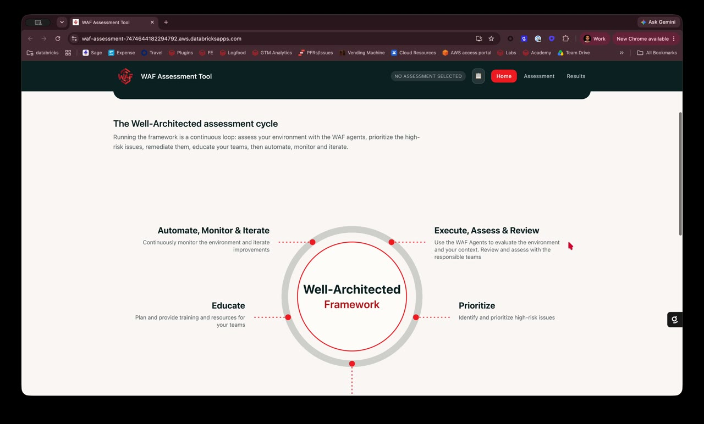
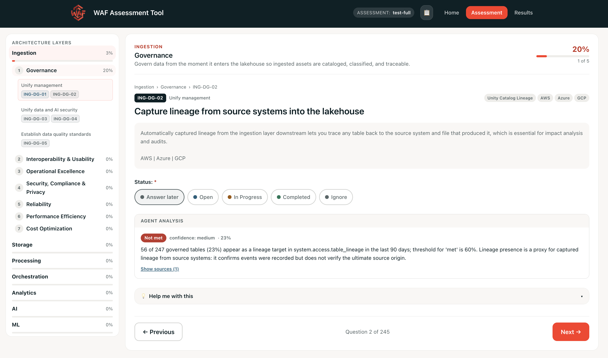

# Databricks Well Architected Framework Assessment Tool

<div align="center">

[](https://www.databricks.com/)
[](./LICENSE)


</div>

A solution for running structured [Databricks Well Architected
Framework](https://docs.databricks.com/en/lakehouse-architecture/index.html)
(WAF) assessments.

Work across the seven pillars of the framework and score each one, with a
breakdown per architecture layer and per pillar.

## Demo

A short walkthrough — creating an assessment, answering questions, and reviewing
the score and backlog. Click to play:

[](./docs/waf-tool-demo.mp4)

## Running an assessment

1. Click **Start New Assessment**, then **New Assessment**
2. Name it, pick the categories that apply and set a cloud provider
3. Answer each question: *Answer later*, *Open*, *In Progress*, *Completed*, or
   *Ignore*
4. Open the **Results** tab for the score and pillar breakdown

Use the 📋 button in the header to switch between assessments, or to export one
as JSON and import it elsewhere.



## Getting started

### Architecture


### Deploying to Databricks

_Pre-reqs:_
- The [Databricks CLI](https://docs.databricks.com/en/dev-tools/cli/index.html)
  (v0.285.0 or newer), authenticated to a serverless-enabled workspace, to
  deploy. Check with `databricks auth profiles`.
- [Node.js](https://nodejs.org/) 20 or newer and [Yarn](https://yarnpkg.com/)
  (`npm install -g yarn`)
- Python 3.10+
- SQL Warehouse provisioned
- Access to Apps, Lakebase, and AI Gateway
- Auth and create databricks profile for workspace `databricks auth login --host <YOUR_WORKSPACE_ENDPOINT>`

```bash
# [Optional] 1. Build the frontend and stage it where the app serves it from
(cd app/frontend && yarn build)
rm -rf app/backend/static && mv app/frontend/dist app/backend/static

# 2. Deploy the bundle (creates/updates the app and its Lakebase resources)
#    The bundle lives in app/, so run the bundle/apps commands from there.
cd app
databricks bundle deploy -t sandbox --profile $DATABRICKS_CONFIG_PROFILE

# 3. Start the app on the new version
databricks bundle run waf_assessment -t sandbox --profile $DATABRICKS_CONFIG_PROFILE

# 4. Check logs
databricks apps logs waf-assessment --profile $DATABRICKS_CONFIG_PROFILE
```

## Contributing

Contributions are welcome — see [CONTRIBUTING.md](CONTRIBUTING.md).

To report a security issue, follow [SECURITY.md](SECURITY.md) rather than opening
a public issue.

## Roadmap

- [ ] WAF Genie Agent integration
- [ ] Embed historical AI/BI Dashboard
- [ ] External resource mapping and lineage

## Additional Assessments
- [SAT - Security Analysis Tool](https://github.com/databricks-industry-solutions/security-analysis-tool)
- [Ontology - Genie Ontology Readiness](https://github.com/databricks-solutions/genie-ontology-readiness/tree/main)
- [RC18 - Regulatory Data Governance](https://github.com/databricks-solutions/regulatory_data_governance)
- [Lakebridge - Facilitate migrations to Databricks](https://github.com/databrickslabs/lakebridge)
- [Forge - Use-case discovery](https://github.com/databricks-solutions/databricks-forge)

## License

Licensed under the [Databricks License](LICENSE). Built on top of and powered by the following open-source projects.

| Library | License |
| ------- | ------- |
| [React](https://github.com/facebook/react) | MIT |
| [Vite](https://github.com/vitejs/vite) | MIT |
| [TypeScript](https://github.com/microsoft/TypeScript) | Apache-2.0 |
| [Emotion](https://github.com/emotion-js/emotion) | MIT |
| [Zustand](https://github.com/pmndrs/zustand) | MIT |
| [Chart.js](https://github.com/chartjs/Chart.js) | MIT |
| [react-chartjs-2](https://github.com/reactchartjs/react-chartjs-2) | MIT |
| [vite-plugin-pwa](https://github.com/vite-pwa/vite-plugin-pwa) / [Workbox](https://github.com/GoogleChrome/workbox) | MIT |
| [Flask](https://github.com/pallets/flask) / [Flask-SQLAlchemy](https://github.com/pallets-eco/flask-sqlalchemy) / [Flask-Migrate](https://github.com/miguelgrinberg/flask-migrate) | BSD-3-Clause |
| [SQLAlchemy](https://github.com/sqlalchemy/sqlalchemy) / [Alembic](https://github.com/sqlalchemy/alembic) | MIT |
| [Gunicorn](https://github.com/benoitc/gunicorn) | MIT |
| [psycopg2](https://github.com/psycopg/psycopg2) | LGPL-3.0 |
